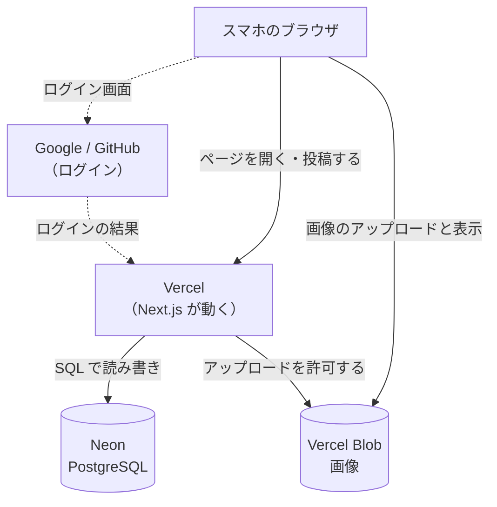
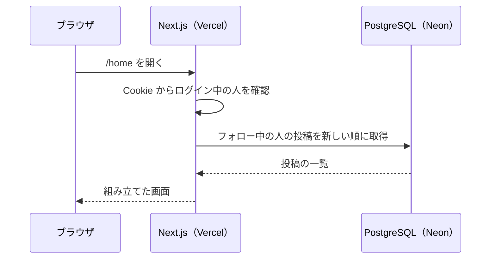
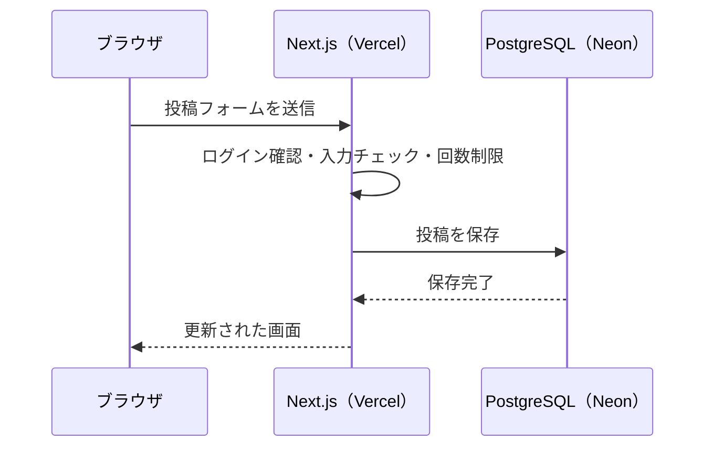
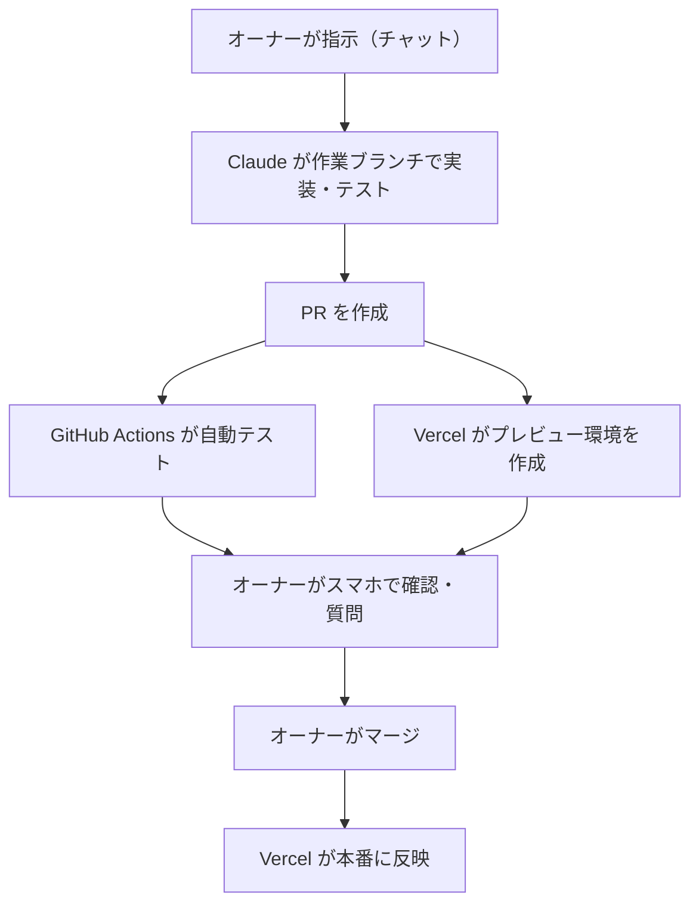

# 00. 全体像: この SNS はどう動くのか

フェーズ0の学習ノートです。これから作る SNS の全体像と、開発の進め方をまとめます。細かい仕組みは、それぞれのステップのノートで掘り下げます。

## 1. 全体の構成

| 登場人物 | 役割 |
| --- | --- |
| ブラウザ | 画面を表示し、ユーザーの操作をサーバーに送る |
| Vercel | Next.js を動かすサーバー。ページを組み立て、投稿などの処理を受け付ける |
| Neon | ユーザー・投稿・フォローなどのデータを保存する PostgreSQL |
| Vercel Blob | アイコンや投稿の画像を保存し、配信する |
| Google / GitHub | 「この人は本人か」を確かめてくれる、ログインの提供元 |

ポイントは、**DB を読み書きするのはサーバー（Vercel）だけ**ということです。ブラウザが DB に直接つながることはありません。ブラウザから届くものはすべて「信用できない入力」として扱い、サーバー側で必ずチェックします。

## 2. 2 つの操作で見る処理の流れ

### タイムラインを開く

Next.js では、このように**サーバー上でデータを取得して画面を組み立てる部品**を Server Components と呼びます。DB の接続情報などの秘密はサーバーの外に出ないので、安全に DB を使えます。

### 投稿する

このように**ブラウザから呼び出せる、サーバー側の関数**を Server Actions と呼びます。「いいね」や「フォロー」も同じ仕組みで作ります。

一方、ボタンの押し心地や入力中の文字数表示など、ブラウザ上で動く必要がある部品は Client Components として作ります。**どこまでがサーバーで、どこからがブラウザか**を意識することが、Next.js の学習の中心になります。

## 3. 3 つの環境

| 環境 | どこで動くか | DB | 用途 |
| --- | --- | --- | --- |
| ローカル | Claude の作業環境 | 作業環境の PostgreSQL | 開発と自動テスト |
| プレビュー | Vercel（PR ごとに別の URL） | 本番 DB のコピー（Neon のブランチ） | マージ前にスマホで確認 |
| 本番 | Vercel（固定の URL） | 本番 DB | 実際に使ってもらう |

プレビューでは本番 DB のコピーを使うので、プレビューで投稿や削除をしても本番には影響しません。

## 4. 開発の流れ

PR の分からない行にコメントを付ければ、Claude が答えます。チャットで質問しても構いません。

## 5. 無料枠が設計を決める

| 制約 | 設計への影響 |
| --- | --- |
| 独自ドメインがなく、メールを確実に届けられない | パスワードを使わない（再設定メールを送れないため）。OAuth とパスキーにする |
| 画像のアップロードは月 2,000 回・保存 1GB まで | ブラウザで縮小してからアップロードする。1 人あたりと全体の上限を設ける |
| Vercel の関数は WebSocket を使えない | リアルタイム更新は、まず定期的な再取得で作る |
| DB は 5 分使われないと休止する | 休止明けの最初の表示が遅くなることは許容する |

制約は不便ですが、「なぜこの設計なのか」を考えるきっかけになります。実務でも、予算・期限・法律などの制約から設計が決まることはよくあります。

## 6. 関連ドキュメント

- [要件定義](../requirements.md)
- [ADR-0002: 技術スタック](../adr/0002-tech-stack.md)
- [ADR-0003: 認証方式](../adr/0003-authentication.md)
- [ADR-0004: 開発の進め方](../adr/0004-development-workflow.md)
- [ADR-0005: テスト方針](../adr/0005-testing-policy.md)
- [ロードマップ](../ROADMAP.md)

## 確認クイズ（任意）

答えをチャットで送ってもらえれば、解説します。

1. ブラウザから DB に直接つながない理由は何でしょう？
2. Server Components と Server Actions の違いを、一言で説明すると？
3. このプロジェクトでパスワードを使わない理由を 2 つ挙げてください
