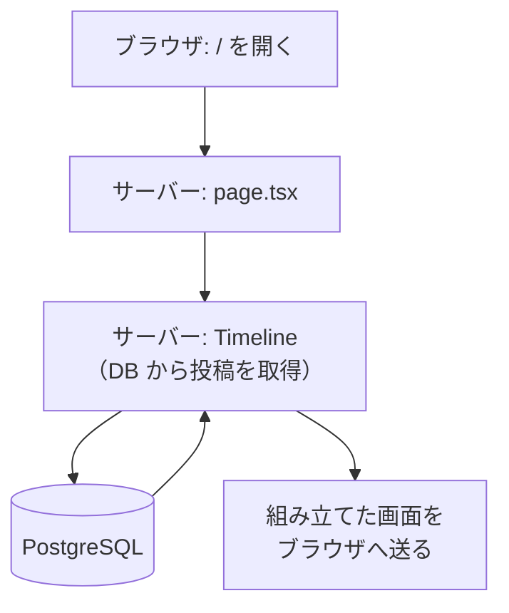
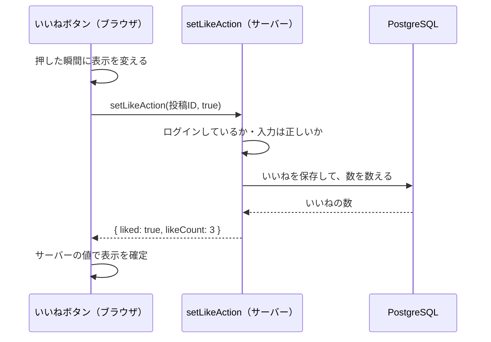

# 01. サーバーとブラウザの分担

M1 の学習ノートです。Next.js（App Router）でいちばん大事な「どの処理をサーバーでやり、どの処理をブラウザでやるか」を、このアプリのコードで確かめます。要点は 3 つだけです。

## まず読む 5 つのファイル

| 順番 | ファイル | 分かること |
| --- | --- | --- |
| 1 | `src/app/page.tsx` | ページ（Server Component）の形と `<Suspense>` |
| 2 | `src/features/posts/components/timeline.tsx` | サーバーで DB からデータを取る |
| 3 | `src/features/posts/components/like-button.tsx` | ブラウザで動く部品（Client Component） |
| 4 | `src/features/posts/actions.ts` | ブラウザからサーバーの処理を呼ぶ（Server Actions） |
| 5 | `src/features/posts/queries.ts` | DB から投稿を取り出すクエリ（サブテーマ） |

## 要点 1: Server Component は「サーバーでデータを取り、画面を組み立てる」

- 先頭に `"use client"` と書いていない部品は、すべて Server Component
- サーバーの上で動くので、DB に直接問い合わせられる（`timeline.tsx` の `await getTimeline(...)`）
- DB の接続情報などの秘密や、部品のプログラム自体はブラウザに送られない。届くのは組み立て終わった画面だけ

### なぜ `<Suspense>` で囲むのか

`page.tsx` は `async` にせず、ログイン状態や DB を読む部分だけを `<Suspense>` で囲んでいます。

- ヘッダーなどの外枠を先に表示し、データが揃った部分から順に流し込める（ストリーミング）
- 待っている間は `fallback` に渡した仮の枠（灰色のスケルトン）が表示される
- Next.js 16 の Cache Components では、囲み忘れるとビルドがエラーで教えてくれる（[ADR-0007](../adr/0007-cache-components.md)）

## 要点 2: Client Component は「ブラウザで動く必要がある部品」だけ

- ファイルの先頭に `"use client"` と書いた部品
- 必要になるのは、次のようなとき
  - 押したら表示を変える（`useState`、`useOptimistic`）
  - 入力に反応する（`onChange`）
  - ブラウザにしかない機能を使う（スクロール位置、確認ダイアログなど）
- このアプリの例
  - `like-button.tsx`: 押した瞬間にハートの色と数を変える
  - `post-composer.tsx`: 入力中に残りの文字数を表示する
  - `post-list.tsx`: 下までスクロールしたら続きを読み込む
- **データはサーバーで取り、props で受け取る**。Client Component が DB に直接アクセスすることはない

### いいねボタンの「楽観的更新」

`like-button.tsx` では、サーバーの返事を待たずに表示を変えています（`useOptimistic`）。返事が来たらその値で確定し、失敗したら元に戻します。押した瞬間に反応するので、通信が遅くても気持ちよく使えます。

## 要点 3: Server Action は「ブラウザから呼べる、サーバーの関数」

- 先頭に `"use server"` と書いたファイル（`actions.ts`）の関数
- ブラウザからは普通の関数のように呼べるが、実際にはサーバーへの通信になる
- **誰でも直接呼び出せる**ので、毎回「ログインしているか」「入力は正しいか」を確かめる（`getRegisteredViewer()` と Zod による検証）
- 処理のあとに `refresh()` を呼ぶと、今のページをサーバーで描き直して最新の状態を表示する

## サブテーマ: DB の設計

テーブルの定義は `src/db/schema.ts` にあります。

- `users`（ユーザー）、`posts`（投稿）、`likes`（いいね）、`follows`（フォロー）
- `likes` は「ユーザー ID と投稿 ID の組み合わせ」を主キーにしている。同じ人が同じ投稿に 2 回いいねすることは、DB の仕組みで防がれる
- 投稿の ID は連番。タイムラインの続きは「この ID より小さい投稿」で取得する（ページ番号を使わないので、読んでいる間に新しい投稿が増えても重複しない）

## 読まなくてよいファイル

品質のために入れていますが、学習の対象外です。

- 自動テスト: `tests/`、`e2e/`、`*.test.ts`
- 設定: `.github/`、`next.config.ts`、`vitest.config.ts`、`playwright.config.ts`、`drizzle.config.ts`、`eslint.config.mjs`、`vercel.json`
- ログインのライブラリの設定: `src/lib/auth.ts`
- 自動で作られる SQL: `drizzle/`
- 作業環境の準備: `scripts/`、`.claude/`

## 確認クイズ（任意）

答えをチャットで送ってもらえれば、解説します。

1. `timeline.tsx` の先頭に `"use client"` を付けたら、何が困るでしょう？
2. いいねボタンが Client Component なのはなぜ？
3. `setLikeAction` の中で、毎回ログインを確かめているのはなぜ？
