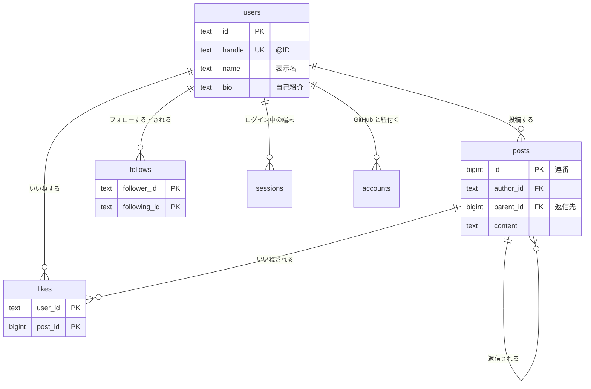
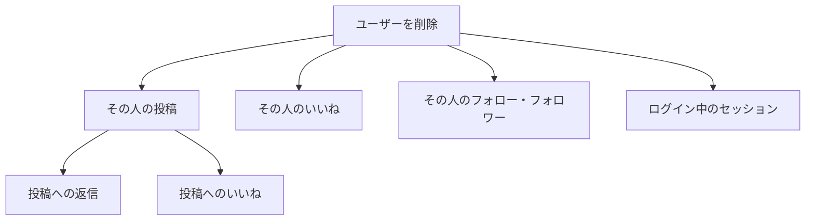
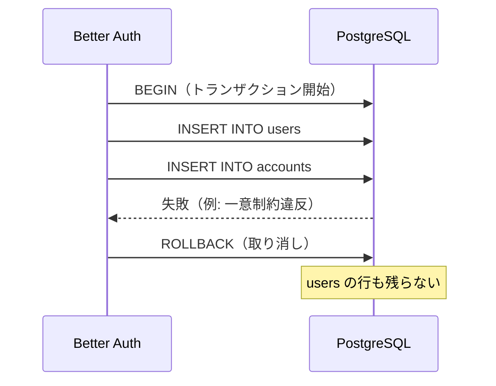
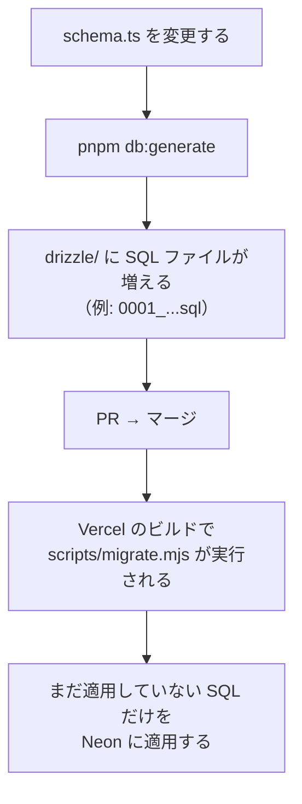

# 02. データベース（PostgreSQL）の設計とクエリ

M1 の学習ノート（DB 編）です。この SNS のデータが「どんな形で保存され」「どう取り出され」「どう守られているか」を、実際のコードと計測結果で説明します。

長いので、章ごとに区切って読んでください。

## まず読む 5 つのファイル

| 順番 | ファイル | 分かること |
| --- | --- | --- |
| 1 | `src/db/schema.ts` | テーブルの定義（列・制約・インデックス） |
| 2 | `drizzle/0000_init.sql` と `drizzle/0001_timeline_index_and_handle_check.sql` | 1 から作られた、実際の SQL |
| 3 | `src/features/posts/queries.ts` | 読み取りのクエリ |
| 4 | `src/features/posts/mutations.ts` | 書き込みと、DB のエラーの扱い |
| 5 | `src/db/schema.test.ts` | 制約が本当に働くかを確かめるテスト |

---

## 1. テーブルの全体像



| テーブル | 1 行が表すもの | 主キー |
| --- | --- | --- |
| `users` | ユーザー 1 人 | `id`（Better Auth が作るランダムな文字列） |
| `posts` | 投稿 1 件（返信も含む） | `id`（連番） |
| `likes` | 「誰が・どの投稿に」いいねしたか | `user_id` と `post_id` の組み合わせ |
| `follows` | 「誰が・誰を」フォローしているか | `follower_id` と `following_id` の組み合わせ |
| `sessions` | ログイン中の端末 1 つ | `id` |
| `accounts` | GitHub アカウントとの紐付け | `id` |

`verifications`（ログイン途中の一時データ）と `rate_limits`（連続アクセスの記録）もありますが、Better Auth が使うだけなので、気にしなくて大丈夫です。

### 1-1. 「多対多」は、つなぐためのテーブルで表す

1 人は多くの投稿にいいねでき、1 つの投稿は多くの人からいいねされます（多対多）。これを `likes` という「つなぐテーブル」で表しています。

`posts` に「いいねした人の一覧」を配列で持たせる方法もありますが、そうしないのは次の理由からです。

- 「この人がいいねした投稿」「この投稿のいいね数」のどちらも、同じ形の SQL で素直に取り出せる
- 同時にいいねが押されても、行が増えるだけなので壊れない（配列を書き換える方式だと、上書きの取り合いが起きる）
- 「同じ人が 2 回いいねできない」を主キーで保証できる

フォローも同じ考え方で、「ユーザーとユーザー」をつなぐ `follows` テーブルにしています。

### 1-2. 返信は、同じ posts テーブルで表す

返信も「本文を持った投稿」なので、別のテーブルを作らず `posts` に入れ、`parent_id`（返信先の投稿の ID）で親子関係を表しています。テーブルが自分自身を参照するので「自己参照」と呼びます。

返信も同じ形なので、画面でも同じ部品（`PostCard`）で表示できます。

### 1-3. 主キーの選び方

- **`posts.id` は連番**: 新しい投稿ほど大きくなるので、「新しい順」の並べ替えと、続きの読み込み（4-2）にそのまま使える
- **`users.id` はランダムな文字列**: Better Auth の決まりに合わせている
- **`likes` と `follows` は 2 列の組み合わせ**: 「同じ人が同じ投稿に 2 回いいね」のような重複が、DB の仕組みで起きなくなる

### 1-4. いいね数は保存せず、そのつど数える

`posts` に「いいね数」の列を持たず、表示のたびに `likes` の行を数えています。

- **良い点**: 数が 1 か所（`likes` の行）にしかないので、ズレが起きない。「いいね数の列を +1 し忘れた」という不具合が原理的に起きない
- **注意点**: 読むたびに数える手間がかかる。ただし 5 章の計測では 1 件あたり 0.02ms ほどで、今の規模では問題にならない

このように「同じ情報を 2 か所に持たない」設計を正規化と呼びます。件数がとても増えたら、数を覚えておく列を足し、いいねの追加と同じトランザクション（6 章）で更新する「非正規化」を検討します。

### 1-5. 日時はタイムゾーン付きで保存する

`created_at` などは `timestamp with time zone` 型です。DB の中では世界共通の時刻（UTC）で保存され、表示するときに日本時間に変換しています（`src/lib/format.ts`）。サーバーがどこの国にあっても、時刻がずれません。

---

## 2. データを守る仕組み（制約）

このアプリは、入力を **2 段構え** で確かめています。

1. **アプリ（Zod）**: 利用者に分かりやすいエラーを返すためのチェック（例: 「280文字以内で入力してください」）
2. **DB の制約**: 何があっても不正なデータを入れないための、最後の砦

| 制約 | このアプリでの例 | 防いでいること |
| --- | --- | --- |
| NOT NULL | `posts.content` | 値が空のまま保存される |
| UNIQUE（一意） | `users.handle`、`users.email` | 同じ @ID が 2 人に付く |
| PRIMARY KEY（2 列） | `likes`、`follows` | 二重いいね・二重フォロー |
| FOREIGN KEY（外部キー） | `posts.author_id` → `users.id` | 存在しないユーザーの投稿 |
| CHECK | 投稿の長さ、自分自身のフォロー、@ID の形式 | ルールに合わない値 |

### 2-1. なぜアプリのチェックだけでは足りないのか

- **同時に来たリクエスト**: 2 人が同時に同じ @ID を登録しようとすると、アプリで「使われていないか確認 → 登録」としても、どちらも確認を通ってしまうことがあります。一意制約なら、DB が 1 件ずつ確実に判定し、2 人目をエラーにします（このアプリは事前の確認をせず、一意制約の判定に任せています）
- **バグや別の経路**: アプリのチェックに漏れがあったり、DB に直接書き込んだりしても、制約は必ず働きます

DB がエラーにしたときは、エラーコード（`23505` = 一意制約違反、`23503` = 外部キー違反）を見て、分かりやすいメッセージに変えています（`src/lib/errors.ts` の `getPgErrorCode` と、各 `mutations.ts`）。

### 2-2. @ID は小文字だけにしている

`users.handle` には「小文字の英数字と `_` で 3〜15 文字」という CHECK 制約があります（`0001` のマイグレーションで追加）。小文字しか入らないので、一意制約が「大文字と小文字を区別しない一意」として働きます（`Taro` と `taro` が別人として登録されることがない）。

### 2-3. 削除は連鎖させている（ON DELETE CASCADE）

外部キーに `onDelete: "cascade"` を付けているので、親を消すと子も自動で消えます。



M4 で作る「アカウント削除」は、この仕組みで本人のデータをまとめて消します。本当に消えることは `src/db/schema.test.ts` で確かめています。

---

## 3. Drizzle ORM: TypeScript で SQL を組み立てる

Drizzle は「SQL に近い書き方で、型の付いたクエリを作る」ライブラリです。

- `schema.ts` に書いたテーブル定義から、TypeScript の型が自動で付く（`posts.content` を数値と取り違えるとエディタが教えてくれる）
- 書いたコードは、ほぼそのままの SQL に変換される

```ts
db.select({ id: posts.id })
  .from(posts)
  .where(and(isNull(posts.parentId), lt(posts.id, cursor)))
  .orderBy(desc(posts.id))
  .limit(21);
```

これが、次の SQL になって DB に送られます。

```sql
select "posts"."id" from "posts"
where ("posts"."parent_id" is null and "posts"."id" < $1)
order by "posts"."id" desc
limit $2
```

### 3-1. `$1` が SQL インジェクションを防ぐ

`cursor` の値は SQL の文字列に埋め込まれず、`$1` という「穴」の分として **SQL 文とは別に** DB へ送られます（プレースホルダー）。値の中に `'; DROP TABLE users; --` のような文字が入っていても、ただの値として扱われるので、SQL として実行されることはありません。

生の SQL を書く `sql` テンプレートの中でも、`${viewerId}` は自動でプレースホルダーになります。

### 3-2. 生の SQL を使っている場所

`queries.ts` では、2 か所だけ `sql` テンプレートで SQL を直接書いています。

- 返信の数: 同じ `posts` テーブルを「外側（投稿）」と「内側（返信）」の 2 役で使うため、内側に `replies` という別名を付けている
- 自分がいいね済みか: `exists (...)` は「1 件でもあるか」を調べる SQL の書き方

Drizzle の書き方より SQL の方が素直に書けるときは、無理をせず SQL を書いています。

---

## 4. 主なクエリの読み解き

### 4-1. タイムラインは、1 回の SQL で 1 ページ分を全部取る

タイムラインの 1 ページ（20 件）には、次の情報が必要です。

- 投稿の本文と日時
- 投稿者の名前・@ID・アイコン（`users` を JOIN）
- いいね数・返信数（投稿ごとに数える「相関サブクエリ」）
- 自分がいいね済みか（`exists`）

これを **1 回の SQL** で取っています（`queries.ts` の `selectPosts`）。

もし「投稿を 20 件取ってから、1 件ずつ投稿者を問い合わせる」と、問い合わせが 1 + 20 回になります。これを **N+1 問題** と呼びます。サーバー（Vercel）と DB（Neon）は別の場所にあるので、1 往復ごとに通信の待ち時間がかかり、回数が増えるほど遅くなります。

### 4-2. 続きの読み込みは OFFSET ではなく cursor で

ページ分けには 2 つの方法があります。

- **OFFSET**: 「先頭から 20,000 件飛ばして、21 件取る」
- **cursor**: 「ID が 21,500 より小さいものを、21 件取る」（このアプリの方法）

5 万件のデータで、同じ場所（1000 ページ目あたり）を取ったときの計測結果です。

| 方法 | DB が読んだ行 | 時間 |
| --- | --- | --- |
| OFFSET | 20,021 行 | 4.06 ms |
| cursor | 21 行 | 0.025 ms |

OFFSET は「飛ばす分も実際に読んでから捨てる」ので、奥のページほど遅くなります。cursor はインデックス（5 章）で目的の位置に直接移動できるので、何ページ目でも速さが変わりません。

もう 1 つの理由として、OFFSET は読んでいる間に新しい投稿が増えると、位置がずれて同じ投稿が 2 回出ます。cursor は「この ID より古いもの」なので、ずれません。

なお、21 件取っているのは「20 件 + 続きがあるかの確認用に 1 件」です。

### 4-3. ホームは「読むときに集める」

ホームには、自分とフォロー中の人の投稿だけを出します。

```sql
where parent_id is null
  and (author_id = '自分'
       or author_id in (select following_id from follows where follower_id = '自分'))
order by id desc
limit 21
```

DB は「新しい投稿から順に見ていき、フォロー中の人の投稿だけを拾う」という動きをします。50 人をフォローしているユーザーで計測すると、関係のない投稿を 398 件読み飛ばして 21 件を集め、0.4ms でした。

この方式は「読むときに集める（fan-out on read）」と呼ばれます。何千万人もいる SNS では、投稿したときに各フォロワーの「受信箱」へ配っておく方式（fan-out on write）も使われますが、今の規模では必要ありません。

---

## 5. インデックス

インデックスは本の索引のようなもので、「どの値の行が、どこにあるか」を並べて記録したものです。これがないと、DB は目的の行を探すために、表の全部の行を読むことになります。

| インデックス | 使われる場面 |
| --- | --- |
| `posts_timeline_idx`（返信以外だけの部分インデックス） | みんな・ホームのタイムライン |
| `posts_author_id_idx`（`author_id`, `id`） | プロフィールの投稿一覧、ユーザー削除時 |
| `posts_parent_id_idx`（`parent_id`, `id`） | 返信の一覧、返信数 |
| `likes` の主キー（`user_id`, `post_id`） | 二重いいねの防止、自分がいいね済みか |
| `likes_post_id_idx` | いいね数 |
| `follows` の主キーと `follows_following_id_idx` | フォロー中・フォロワー |

一意制約（`handle`、`email` など）は、DB が自動でインデックスを作ります。

### 5-1. 実行計画で確かめる（EXPLAIN ANALYZE）

`EXPLAIN ANALYZE` を付けて SQL を実行すると、DB が「どのインデックスを使い、何行読み、何ミリ秒かかったか」を教えてくれます。

計測に使ったデータは、ユーザー 1,000 人、投稿 5 万件（うち返信 3 割）、いいね 20 万件、フォロー 5 万件です（このノートのための計測用で、アプリには入っていません）。

プロフィールの投稿一覧を取ったときの実行計画（読みやすいように一部を省略）です。

```text
Limit (rows=21)
  -> Index Scan Backward using posts_author_id_idx on posts (rows=21)
       Index Cond: (author_id = 'u1')
       Filter: (parent_id IS NULL)
       Rows Removed by Filter: 5
Execution Time: 0.108 ms
```

- `Index Scan Backward using posts_author_id_idx`: `(author_id, id)` のインデックスを、ID の大きい方（新しい方）から順に読んだ
- `Index Cond`: インデックスで絞り込んだ条件（この人の投稿だけ）
- `Filter` と `Rows Removed by Filter: 5`: 読んだあとで、返信 5 件を捨てた
- 結果として 26 行だけ読み、0.1 ms で終わった

主なクエリの計測結果をまとめると、次のとおりです。

| クエリ | 使われたインデックス | 投稿を読んだ行数 | 時間 |
| --- | --- | --- | --- |
| みんなのタイムライン（いいね数などを含む 1 ページ） | `posts_timeline_idx` | 21 | 1.4 ms |
| ホームのタイムライン | `posts_timeline_idx` | 419 | 0.4 ms |
| プロフィールの投稿一覧 | `posts_author_id_idx` | 26 | 0.1 ms |
| 本文の部分一致（`like '%…%'`） | なし（全件を読む） | 50,000 | 5.3 ms |

### 5-2. 部分インデックスの効果は「今は小さい」

`posts_timeline_idx` は、返信ではない投稿（`parent_id is null`）だけを集めた **部分インデックス** です。

試しにこのインデックスを外して、みんなのタイムラインを計測すると、DB は主キーのインデックスを使い、返信を 8 件読み飛ばして 29 行を読みました。時間はほぼ変わりません。返信が 3 割程度なら、差はわずかです。

それでも入れているのは、返信の割合が増えても（返信の多いコミュニティでも）、タイムラインが読む行数が増えないようにするためです。大きさは 5 万件で 784 kB と小さく、費用に見合うと判断しました。

ただし、インデックスは書き込みのたびに更新されるので、何でも付ければよいわけではありません。**測ってから判断する** のが基本です。

### 5-3. インデックスが効かない検索

`content like '%カフェ%'` のような「途中に含まれるか」の検索は、普通のインデックスでは探せません。上の計測では全 5 万行を読んで 5.3 ms かかり、データが増えるほど遅くなります。検索機能（M5）では、日本語の全文検索のための別の仕組みを使います。

---

## 6. 書き込みとトランザクション

### 6-1. トランザクションとは

**複数の書き込みを「全部成功するか、全部なかったことになるか」のどちらかにする仕組み** です。途中で失敗したら、それまでの書き込みも取り消されます（ロールバック）。

### 6-2. 1 つの SQL 文は、それだけでトランザクションになる

PostgreSQL では、1 つの SQL 文は自動的に 1 つのトランザクションとして実行されます。そこでこのアプリでは、投稿・いいね・フォロー・初回登録を、**1 文で完結する** ように書いています。

- **いいね**: `insert ... on conflict do nothing`（すでにあれば何もしない）。「切り替え」ではなく「この状態にする」形なので、同じリクエストが 2 回届いても結果は同じ（冪等）
- **初回登録**: `update users set handle = ... where id = ... and handle is null`。「まだ空なら」の確認と更新が 1 文なので、確認と書き込みの間に他のリクエストが割り込めない
- **投稿の削除**: `delete from posts where id = ... and author_id = 自分`。本人確認と削除が 1 文なので、他人の投稿は消せない

### 6-3. 複数の文をまとめる必要がある場所: 初めてのログイン

初めて GitHub でログインした人には、次の 2 つの書き込みが行われます。

1. `users` にユーザーを作る
2. `accounts` に GitHub アカウントとの紐付けを作る

もし 2 だけが失敗すると、「紐付けのないユーザー」が残ります。中途半端なデータが残ること自体が問題ですし、メールアドレスの確認状況によっては、次にログインしようとしたときに「同じメールアドレスのユーザーはいるのに、GitHub アカウントが紐付いていない」としてログインできなくなる場合もあります。

そこで Better Auth の設定（`src/lib/auth.ts`）で `transaction: true` にし、この 2 つを 1 つのトランザクションにしています。



`src/lib/auth.test.ts` で、紐付けをわざと失敗させ、ユーザーも残らないことを確かめています。実際に `transaction: false` に戻すと、このテストは失敗しました（中途半端なユーザーが残った）。つまり、この設定がなかったときには本当に起こりうる不具合でした。

---

## 7. マイグレーション: テーブル定義の変更履歴

テーブルの定義を変えるときは、次の流れで本番の DB に反映します。



- 今回、部分インデックスと @ID の CHECK 制約を足したので、`0001_timeline_index_and_handle_check.sql` が増えました。中身は `CREATE INDEX` と `ALTER TABLE ... ADD CONSTRAINT` の 2 文だけです
- どこまで適用したかは、DB の中の `drizzle.__drizzle_migrations` テーブルに記録されます
- **一度本番に適用したマイグレーションは書き換えない**。直したいときは、新しいファイルを足す
- 列の削除のように、動いているアプリと両立しない変更は 2 回に分ける（先にコードがその列を使わないようにしてから、次のデプロイで列を消す）

---

## 8. DB への接続（コネクションプール）

- **接続は使い回す**: DB への接続を作るには、暗号化（TLS）の準備や認証で時間がかかります。そこで接続をいくつか作っておき、問い合わせのたびに使い回します。これを接続プールと呼びます（`src/db/index.ts`。1 台のサーバーで最大 10 本）
- **Neon の 2 種類の接続先**: Neon には「プール付き」（たくさんのサーバーからの接続をまとめる、PgBouncer という仕組み）と「直接」の 2 種類の接続先があります。アプリはプール付き（`DATABASE_URL`）、マイグレーションは直接（`DATABASE_URL_UNPOOLED`）を使います
- **待ちすぎない**: 接続に 10 秒かかったら諦めてエラーにします。PostgreSQL のドライバー（pg）の初期設定は「いつまでも待つ」なので、DB に問題があるとページの表示が止まってしまうためです
- **同じ場所に置く**: サーバーと DB はどちらもシンガポールにあります。同じ地域なら 1 往復 1〜2 ms ですが、東京とシンガポールの間だと 1 往復 70 ms 前後かかります。1 ページを表示するのに何回か問い合わせるので、この差は積み上がります

---

## 9. 無料枠にどこまで入るか

5 章の計測データ（ユーザー 1,000 人、投稿 5 万件、いいね 20 万件、フォロー 5 万件）の大きさは、インデックスを含めて約 38 MB でした。

| テーブル | 行数 | 大きさ |
| --- | --- | --- |
| `likes` | 約 20 万 | 22 MB |
| `posts` | 5 万 | 9.4 MB |
| `follows` | 約 5 万 | 5.6 MB |
| `users` | 1,000 | 0.3 MB |

Neon の無料枠は 0.5 GB なので、この約 13 倍（投稿 60 万件ほど）まで入ります。想定している規模（登録者は数百人）には十分です。

---

## 確認クイズ（任意）

答えをチャットで送ってもらえれば、解説します。

1. `likes` テーブルの主キーを、`user_id` と `post_id` の 2 列の組み合わせにしているのはなぜ？
2. 奥のページを OFFSET で取ると遅くなるのはなぜ？
3. 初めてのログインの書き込みをトランザクションでまとめないと、何が起きる？
