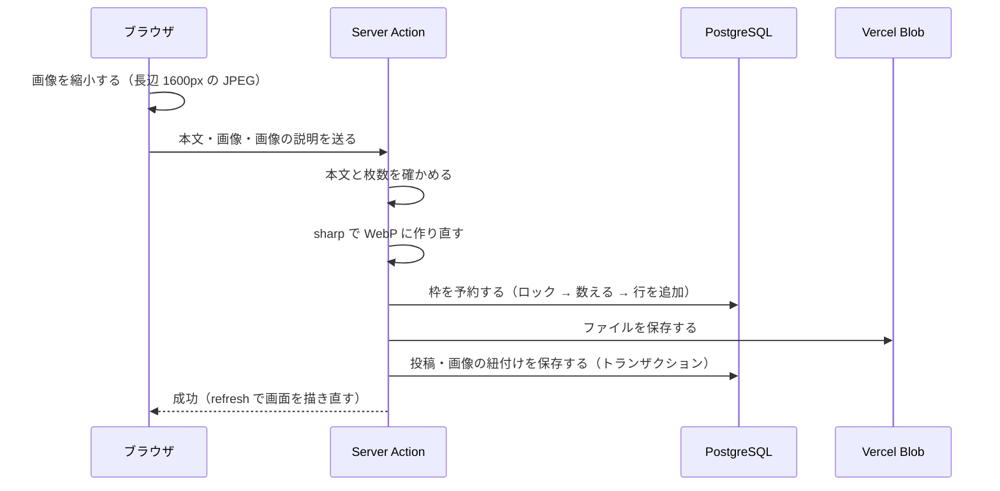
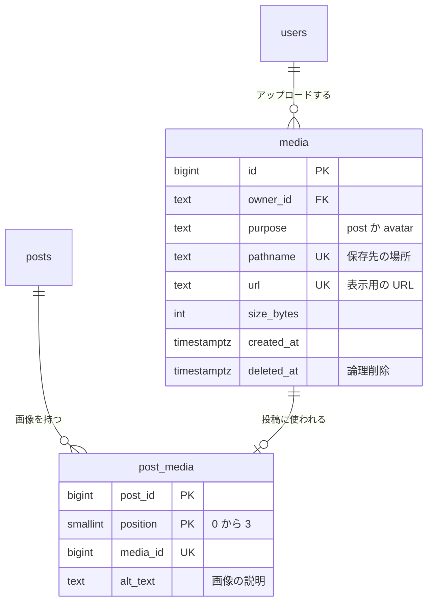
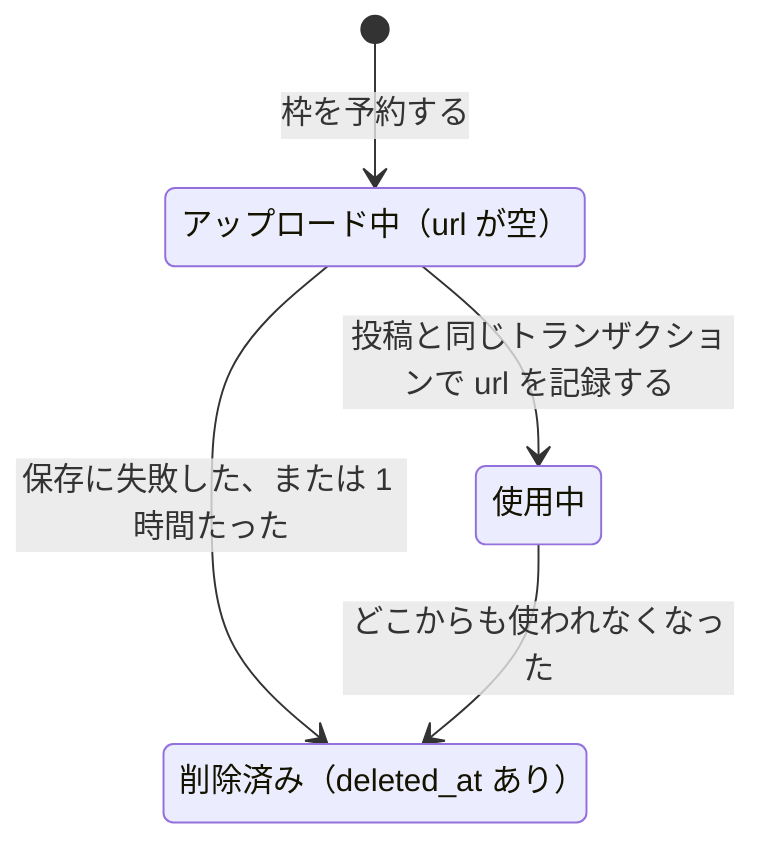
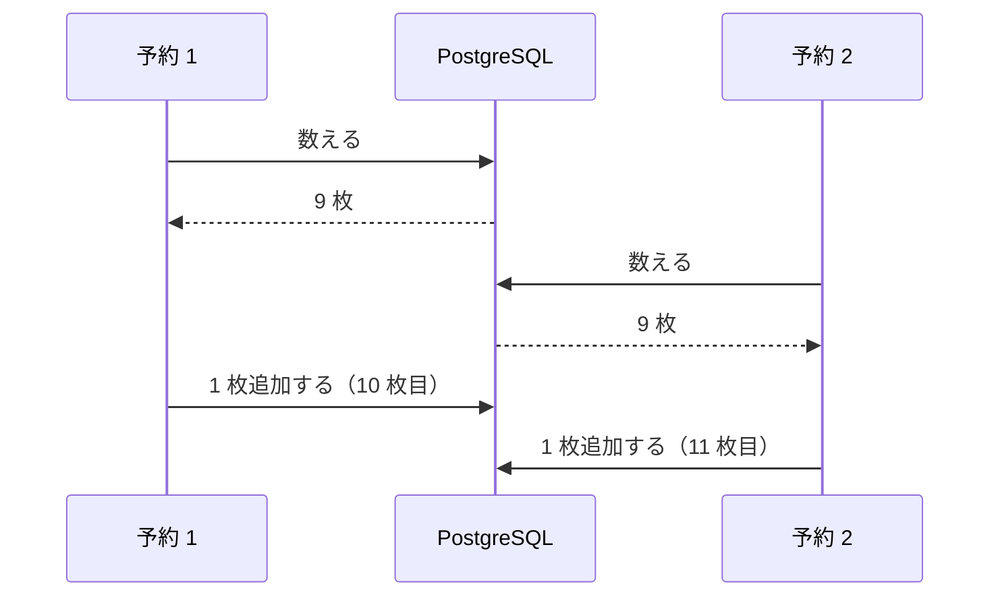
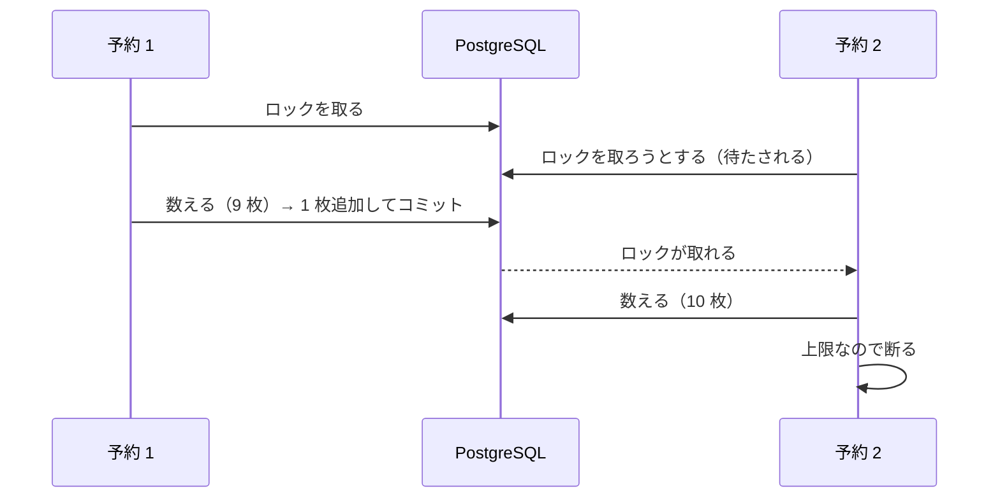

# 03. 画像のアップロード（サーバーとブラウザ・DB）

M2 の学習ノートです。画像付きの投稿が保存されるまでに、ブラウザ・サーバー・DB・Vercel Blob がそれぞれ何をしているかを説明します。

前半（1〜2 章）は「サーバーとブラウザの分担」、後半（3〜6 章）は「DB の設計とクエリ」のテーマです。設計の判断の理由は [ADR-0008](../adr/0008-image-storage.md) にまとめてあります。

## まず読む 5 つのファイル

| 順番 | ファイル | 分かること |
| --- | --- | --- |
| 1 | `src/features/media/mutations.ts` | 枠の予約・アップロード・片付け（このノートの中心） |
| 2 | `src/db/schema.ts` の `media` と `post_media` | 画像のテーブル |
| 3 | `src/features/posts/mutations.ts` の `createPost` | 投稿と画像を 1 つのトランザクションで保存する |
| 4 | `src/features/posts/components/post-composer.tsx` | ブラウザで縮小して送る |
| 5 | `src/features/media/image.ts` | サーバーで画像を作り直す（sharp） |

---

## 1. 全体の流れ

画像を 2 枚付けて投稿したときの流れです。



ポイントは 2 つです。

- Blob に保存する**前に**、DB で枠を予約する（4・5 章）
- 投稿の保存に失敗したら、保存したファイルを消す（5 章）

---

## 2. サーバーとブラウザの分担

### 2-1. ブラウザで縮小する

**なぜ必要か**: スマホの写真は 1 枚 3〜10MB あります。Vercel の関数が受け取れるのは 4.5MB までなので、4 枚どころか 1 枚でも超えることがあります。

**どう動くか**: 選んだ画像を `<canvas>` に小さく描き直し、JPEG として書き出します。目標の大きさ（約 900KB）に収まるまで、画質を少しずつ下げて試します。canvas から書き出した画像には、撮影場所などのメタデータが付きません。

**このコードのどこか**: `src/features/media/resize.ts` の `prepareImage`。投稿フォームで画像を選んだときに呼ばれます。

### 2-2. それでもサーバーで作り直す

ブラウザで動くコードは、利用者がいくらでも書き換えられます。ブラウザを通さずに、直接サーバーへ送ることもできます。そのため「位置情報を消す」「画像以外を受け付けない」といった約束は、**必ずサーバーで**守ります（`src/features/media/image.ts`）。

| 確かめること | 方法 |
| --- | --- |
| 本当に画像か | ファイル名や種類の申告は偽れるので、中身の先頭のバイト列から形式を判定する（JPEG・PNG・WebP だけ） |
| 大きすぎないか | 縦×横が 2,500 万ピクセルを超えたら断る。小さなファイルに巨大な画像を詰めた「画像爆弾」で、メモリを使い果たさせる攻撃を防ぐ |
| 写真の向き | スマホの写真は「回転して表示する」という情報だけを持っていることがある。画素そのものを回転させてから保存する |
| メタデータ | WebP に作り直すときに、撮影場所（GPS）などをすべて取り除く |

テスト（`src/features/media/image.test.ts`）で、GPS 付きの画像から GPS が消えること、画像爆弾を断ることなどを確かめています。

### 2-3. Server Action でファイルを受け取る

Server Action は、フォームの内容（`FormData`）をそのまま受け取れます。ファイルも `formData.getAll("images")` で `File` として取り出せます（`src/features/posts/actions.ts`）。

注意点が 2 つあります。

- **大きさの上限**: Server Action が受け取れるのは、初期設定では 1MB まで。`next.config.ts` の `bodySizeLimit` で 4MB に広げている
- **JavaScript が必要**: 縮小した画像をフォームに足すため、`<form action={submit}>` にブラウザの関数（`submit`）を渡し、その中で Server Action を呼んでいる。ブラウザの関数を挟むと、JavaScript の読み込みが終わるまでフォームを送れない（M1 のように Server Action をそのまま渡すと、読み込み前でも送れる）

### 2-4. 表示は Blob の URL のまま

Next.js の `<Image>` は、普通は Vercel の画像最適化（大きさや形式の変換）を通します。この無料枠は月 5,000 回です。保存するときにすでに WebP・適切な大きさにしているので、`unoptimized` を付けて Blob の URL のまま表示しています（`src/features/posts/components/post-images.tsx`）。

---

## 3. 画像のテーブル設計



| テーブル | 1 行が表すもの |
| --- | --- |
| `media` | アップロードされた画像 1 枚（投稿の画像とアイコンの両方） |
| `post_media` | 「どの投稿の、何枚目に、どの画像を使うか」と、その画像の説明 |

アイコンは `users.image` に URL を入れています（M1 から GitHub のアイコンの URL が入っていた列です）。外部キーではないので、「今のアイコンかどうか」は URL が同じかどうかで判断します（5-4）。

### 3-1. 1 行の 3 つの状態



- **アップロード中**: 枠だけ予約した状態。Blob にファイルがあるとは限らない
- **使用中**: 投稿やアイコンとして表示されている
- **削除済み**: ファイルは消した。行は「何枚アップロードしたか」を数えるために残す（3-3）

### 3-2. 1 つの投稿に 4 枚まで、を DB でも守る

`post_media` の主キーを「投稿 ID と何枚目か（`position`）」の組み合わせにし、`position` を 0〜3 に限っています。

```sql
CONSTRAINT "post_media_post_id_position_pk" PRIMARY KEY("post_id","position"),
CONSTRAINT "post_media_position_range" CHECK ("post_media"."position" between 0 and 3)
```

同じ投稿の同じ番号は 2 回使えず、番号は 4 種類しかないので、1 つの投稿に付く画像は最大 4 枚になります。アプリの「4 枚まで」のチェックをすり抜けても、DB が 5 枚目を拒否します（`src/db/schema.test.ts`）。

`media_id` には一意制約を付けています。1 枚の画像を 2 つの投稿で使い回すことはないからです。

### 3-3. 論理削除: 行を消さずに「削除済み」の印を付ける

画像を消しても、`media` の行は消さずに `deleted_at` に日時を入れます。これを**論理削除**と呼びます（行を本当に消すのは「物理削除」）。

**なぜ必要か**: 「1 人 24 時間で 10 枚まで」を数えるとき、消した画像も数える必要があります。行ごと消してしまうと、「10 枚アップロード → 全部消す → また 10 枚」を繰り返せてしまい、Blob の回数（月 2,000 回）を使い切られてしまいます。

**代わりに増える注意点**: 「使用中の画像だけ」を扱うクエリでは、毎回 `deleted_at is null` の条件を忘れずに付ける必要があります。また、削除済みの行はたまり続けます（速さへの影響は 6 章）。

---

## 4. 同時に送られても上限を超えないようにする

### 4-1. 何が起きるか

上限の確認は「今の枚数を数える → 上限より少なければ追加する」の 2 段階です。2 つのアップロードがほぼ同時に届くと、次のことが起こります。



どちらも「9 枚だから、あと 1 枚いける」と判断し、上限の 10 枚を超えてしまいます。M1 のように 1 つの SQL 文で済む書き込み（`on conflict do nothing` など）と違い、「数えて、判断して、追加する」は複数の文にまたがるので、トランザクションを使うだけでは防げません（PostgreSQL の標準の設定では、ほかのトランザクションがまだコミットしていない行は見えないため）。

### 4-2. アドバイザリロックで 1 件ずつ順番にする

PostgreSQL の**アドバイザリロック**は、アプリが自由に決めた番号に対してかけるロックです。同じ番号のロックを取れるのは同時に 1 つのトランザクションだけで、ほかは先のトランザクションが終わるまで待たされます。

```sql
select pg_advisory_xact_lock(1001)
```

- `1001` は「アップロードの枠の予約」用に、このアプリの中で決めた番号（`UPLOAD_QUOTA_LOCK`）
- 名前に `xact` が付くものは、トランザクションが終わる（コミットまたはロールバック）と自動で外れる。外し忘れがない



**このコードのどこか**: `src/features/media/mutations.ts` の `reserveMedia`。トランザクションの最初でロックを取り、数えて、行を追加してから、コミットでロックを外します。

ロックの間は、ほかの人の予約も待たされます。予約は数ミリ秒で終わり、画像のアップロードは多くても月 1,600 回なので、待ち時間は問題になりません。

### 4-3. 実験: ロックがないと本当に超えるのか

同じ人が 1 枚ずつ、15 件の予約を同時に送るテストを用意しました（`src/features/media/media.test.ts` の「同時に 15 件の予約が届いても…」）。上限は 10 件です。

| ロック | 通った件数（5 回試した結果） |
| --- | --- |
| なし（ロックの 1 行を消して試した） | 12・15・15・15・15 件 |
| あり | 毎回ちょうど 10 件 |

ロックがないと、ほとんどの場合 15 件すべてが通ってしまいました。このテストは CI で毎回動いているので、ロックをうっかり消すとテストが失敗します。

### 4-4. ほかの方法

- **トランザクションの分離レベルを `SERIALIZABLE` にする**: 矛盾が起きそうな同時実行を PostgreSQL が検出して、片方をエラーにしてくれる。ただし、エラーになった方をやり直す処理を自分で書く必要がある
- **数を記録した行を `select ... for update` でロックする**: 「今月のアップロード数」のような集計用の行を作り、その行をロックする。数え直さなくてよい代わりに、集計の行と実際の行がずれないように気を付ける必要がある

この SNS では、もっとも単純で確実なアドバイザリロックを選びました。

---

## 5. 先に予約し、失敗したら片付ける

### 5-1. なぜ Blob に保存する「前」に予約するのか

Blob の無料枠の回数は、保存を**試みた時点**で使われます。先に保存してから上限を確かめる順番だと、同時に 100 件届いたときに 100 回分の回数を使ってから 90 件を断ることになり、回数の上限を守れません。

### 5-2. url を記録するのは、投稿と同じトランザクションで

予約した行は、ファイルを保存したあとも、しばらく「アップロード中」（`url` が空）のままにしておきます。`url` を記録して「使用中」にするのは、投稿の保存と**同じトランザクションの中**です（`createPost` の中の `markMediaInUse`）。

```ts
await db.transaction(async (tx) => {
  const [created] = await tx.insert(posts).values({ ... }).returning({ id: posts.id });
  await markMediaInUse(tx, uploaded);              // url を記録する
  await tx.insert(postMedia).values([ ... ]);      // 投稿と画像を紐付ける
});
```

もし `url` を先に記録すると、「url はあるのに、どの投稿にも付いていない」瞬間ができます。その瞬間にほかの人の片付け（5-4）が動くと、使う予定の画像を「使われていない」と判断して消してしまいます。同じトランザクションにすれば、ほかの処理からは「両方まだ」か「両方済み」のどちらかしか見えません。

### 5-3. 失敗したときの後片付け

投稿の保存に失敗したとき（返信先が同時に削除された、など）は、`discardMedia` で保存したファイルを消し、行を「削除済み」にします。

順番は「ファイルを消す → 行を削除済みにする」です。逆にすると、ファイルの削除に失敗したときに「削除済みなのにファイルが残っている」状態になり、二度と見つけられなくなります。この順番なら、途中で失敗しても行は「アップロード中」のまま残り、1 時間以上たってからの片付け（5-4）で消えます。

### 5-4. 使われていない画像を探して片付ける

投稿を消したときは、「この投稿の画像を消す」と指定するのではなく、**どこからも使われていない画像**を DB から探して消します（`deleteUnusedMedia`）。

```sql
select id, pathname from media
where deleted_at is null and (
  -- 投稿の画像なのに、どの投稿にも付いていない
  (purpose = 'post' and url is not null
    and not exists (select 1 from post_media where post_media.media_id = media.id))
  -- アイコンなのに、持ち主の今のアイコンではない
  or (purpose = 'avatar' and url is not null
    and not exists (select 1 from users where users.id = media.owner_id and users.image = media.url))
  -- アップロード中のまま 1 時間たった
  or (url is null and created_at < now() - interval '1 hour')
)
limit 100
```

`not exists (...)` は「条件に合う行が 1 つもない」という意味です（**アンチ結合**と呼ばれます）。

**なぜ個別に指定しないのか**: 投稿を消すと、ON DELETE CASCADE で返信も消えます（M1）。返信には、ほかの人が付けた画像があるかもしれません。「消えた投稿の画像」を正確に集めるのは、返信の返信まで含めると意外と大変です。「どこからも使われていない画像」を探す方法なら、連鎖して消えた画像も、以前の片付けが失敗して残った画像も、まとめて見つかります。

### 5-5. ほかの環境のファイルは消さない

Blob の保存場所は本番とプレビューで共通です。そこで、ファイルの場所の先頭に環境名を付けています（例: `production/post/<ランダムな ID>.webp`）。

プレビューの DB は本番のコピーなので、プレビューで投稿を消すと、本番の画像の行も「使われていない」と判断されます。このとき、行は「削除済み」にしますが、ファイルは `production/` から始まるので消しません（`src/features/media/storage.ts` の `deleteFiles`）。

---

## 6. 計測（EXPLAIN ANALYZE）

### 6-1. 計測の条件

ローカルの PostgreSQL 16 に、無料枠を上限まで使った状態のデータを作って計測しました（M1 の計測データに追加）。

| データ | 内容 |
| --- | --- |
| A: 無料枠いっぱい | `media` 6,810 行（使用中の投稿の画像 5,005・アイコン 600・削除済み 1,200・アップロード中 5）、`post_media` 5,005 行 |
| B: 5 年後 | A に、削除済みの行を 9 万行追加（96,810 行）。論理削除で行がたまり続けた場合 |

時間は、それぞれ 15 回以上実行したときの中央値です。

### 6-2. 上限の確認（予約のたびに実行）

| クエリ | 索引なし（A） | 索引あり（A） | 索引なし（B） | 索引あり（B） |
| --- | --- | --- | --- | --- |
| 本人の直近 24 時間の枚数 | — | 0.02ms | — | — |
| 全体の直近 31 日の枚数 | 1.42ms | 0.38ms | 2.95ms | 0.21ms |
| 使用中の画像の合計容量 | 1.08ms | 0.67〜1.18ms | 8.80ms | 0.69ms |

- 「本人の直近 24 時間」は、最初から `(owner_id, created_at)` の索引を使っています（ユーザー削除時に外部キーをたどるのにも必要なため）。索引だけで数え終わる（Index Only Scan）ので、とても速い
- 「合計容量」は、データ A では索引の有無で差がありません。使用中の 5,610 行を全部足す必要があるのは、どちらも同じだからです
- データ B（5 年後）では、索引がないと削除済みの 9 万行も読むので、索引ありより 10 倍以上遅くなります

索引ありのときの「合計容量」の実行計画（データ B）:

```
Aggregate  (actual time=0.681..0.681 rows=1 loops=1)
  ->  Index Only Scan using media_live_idx on media  (actual time=0.013..0.439 rows=5610 loops=1)
        Heap Fetches: 0
```

`media_live_idx` は、`deleted_at is null` の行だけを含む**部分インデックス**です（M1 のタイムラインの索引と同じ仕組み）。削除済みの行がどれだけ増えても、この索引の大きさは「使用中の行の数」で決まります。使用中の行は容量の上限（800MB）で頭打ちになるので、速さも頭打ちのまま保たれます。

### 6-3. 片付け（投稿を消すたびに実行）

5-4 のクエリの計測結果です（データ B）。

| 索引 | 時間 | 読んだ行 |
| --- | --- | --- |
| なし | 10.75ms | 全 96,810 行（Seq Scan） |
| `media_live_idx` あり | 3.0ms | 使用中の 5,610 行だけ（Bitmap Index Scan） |

`not exists` の部分は、PostgreSQL が `post_media` と `users` を先に 1 回だけ読み、ハッシュ表（すぐに引ける一覧）にしてから照らし合わせています（実行計画の `hashed SubPlan`）。

### 6-4. 決めたこと

- `media_created_at_idx`（`created_at` の索引）と、`media_live_idx`（部分インデックス）を追加した
- 今のデータ量では差は 1ms 前後と小さい。それでも追加したのは、論理削除の行はたまり続けるので、索引がないと時間とともに遅くなり続けるため。書き込み（アップロード）は多くても月 1,600 回なので、索引を保つ手間はほぼない
- FILTER を使って 3 つの数を 1 回の Seq Scan でまとめて数える書き方も試した。データ A では 1.87ms、データ B では 19.8ms だった。索引を使える別々の数え方の方が速いので、1 つの SQL の中に 3 つの副問い合わせを並べる形にした（`getUsage`）

### 6-5. タイムラインに画像を加えたときの速さ

タイムラインの 1 ページ（21 件）を取得するクエリに、画像の副問い合わせを足しました（`src/features/posts/queries.ts`）。

```sql
coalesce((
  select json_agg(json_build_object('url', media.url, ...) order by post_media.position)
  from post_media join media on media.id = post_media.media_id
  where post_media.post_id = posts.id
), '[]'::json)
```

`json_agg` は、複数の行を 1 つの JSON の配列にまとめる関数です。投稿 1 件につき、画像を「1 つの列」として受け取れます。

| クエリ | 時間 |
| --- | --- |
| 画像なし（M1） | 0.15ms |
| 画像あり（21 件中 6 枚の画像） | 0.40ms |

画像は `post_media` の主キーの索引（`post_id, position`）で探しています。

**N+1 問題**: 投稿を 20 件取ってから、投稿ごとに画像を問い合わせると、DB との往復が 1 + 20 回になります。これを N+1 問題と呼びます。往復には 1 回ごとに通信の時間がかかるので（同じ地域どうしでも 1 回あたり数ミリ秒かかることがあります）、1 回の SQL でまとめて取る方が速くなります。

---

## 7. リンクのプレビュー（OGP）

**なぜ必要か**: 投稿のリンクを LINE や X に貼ったとき、タイトル・説明・画像のカードを表示してもらうためです。

**どう動くか**: LINE などのサービスはリンク先のページを取得し、`<head>` の中の `<meta property="og:title">` などを読みます。Next.js では、ページに `generateMetadata` を書くと、これらのタグを出してくれます。

```ts
export async function generateMetadata({ params }): Promise<Metadata> {
  const post = await getPost(...);
  return {
    title: "アリスさんの投稿「…」",
    openGraph: { ...baseOpenGraph, type: "article", title: "...", description: "..." },
  };
}
```

**このコードのどこか**: `src/app/posts/[postId]/page.tsx` と `src/app/u/[handle]/page.tsx`。共通の設定は `src/lib/site.ts`。

知っておくと良いこと:

- **メタデータも後から流し込まれる**: DB を読む `generateMetadata` は、ページの中身と同じように後から流し込まれ、普通のブラウザでは `<body>` の中にタグが追加される。ただし、LINE や X のプレビュー用のロボットのように JavaScript を動かさない相手には、Next.js が気づいて `<head>` に入れてから返す（`facebookexternalhit` などの名前で見分けている）。E2E テストでもロボットの名前を名乗って確かめている
- **openGraph は丸ごと置き換わる**: ページで `openGraph` を書くと、親（layout）の `openGraph` は引き継がれない。サイト名や共通の画像を毎回入れるため、`baseOpenGraph` を広げて（`...baseOpenGraph`）使っている
- **画像の URL は完全な形にする**: プレビューの画像は `https://` から始まる URL である必要がある。layout の `metadataBase` にサイトの URL を設定しておくと、`/og-image.png` のような書き方で済む

---

## 読まなくてよいファイル

| ファイル | 中身 |
| --- | --- |
| `src/features/media/storage.ts` | 保存先（Blob とディスク）の切り替え |
| `src/app/local-media/[...path]/route.ts` | ローカル開発・テストで、ディスクの画像を配信する |
| `src/features/posts/components/post-images.tsx`、`src/features/users/components/avatar-form.tsx` | 画像の並べ方、アイコンの変更フォーム（見た目） |
| `scripts/generate-og-image.mjs`、`public/og-image.png` | プレビュー用の共通画像とその作り方 |
| `src/**/*.test.ts`、`e2e/`、`tests/` | テスト |

---

## 確認クイズ（任意）

1. ブラウザで画像を縮小しているのに、サーバーでも作り直すのはなぜ？
2. 「数える → 追加する」をトランザクションで囲むだけでは、上限を守れないのはなぜ？
3. `pg_advisory_xact_lock` で取ったロックは、いつ外れる？
4. Blob に保存する前に枠を予約するのはなぜ？
5. 画像の `url` を、投稿の保存と同じトランザクションで記録するのはなぜ？
6. 削除済みの画像の行を消さずに残しているのはなぜ？ それによってどんな索引が必要になった？

<details>
<summary>答え</summary>

1. ブラウザのコードは利用者が書き換えられ、ブラウザを通さずに送ることもできるため。位置情報の除去や形式の確認は、サーバーで行わないと守れない
2. 同時に動く 2 つのトランザクションが、お互いのまだコミットしていない行を見られず、どちらも「上限に届いていない」と判断してしまうため
3. トランザクションが終わったとき（コミットまたはロールバック）
4. Blob の回数は保存を試みた時点で使われるため。先に保存すると、上限を超えた分まで回数を使ってしまう
5. 別々にすると「url はあるのに投稿に付いていない」瞬間ができ、その間に片付けが動くと、使う予定の画像を消してしまうため
6. 「24 時間に何枚アップロードしたか」に、消した画像も数えるため。削除済みの行がたまっても速さが落ちないよう、使用中の行だけの部分インデックス（`media_live_idx`）と、`created_at` の索引を追加した

</details>
