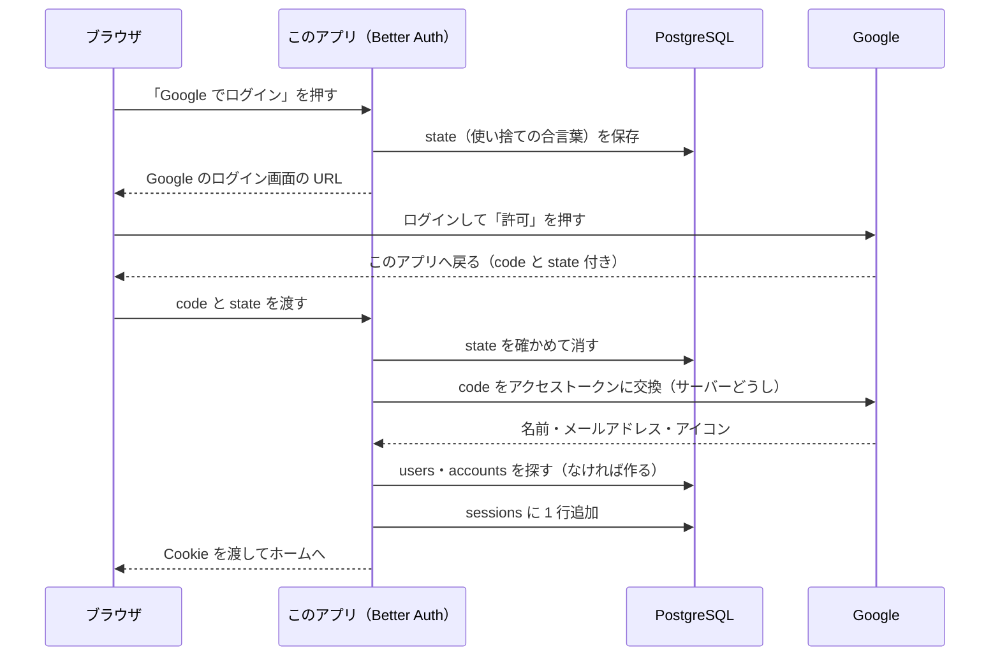
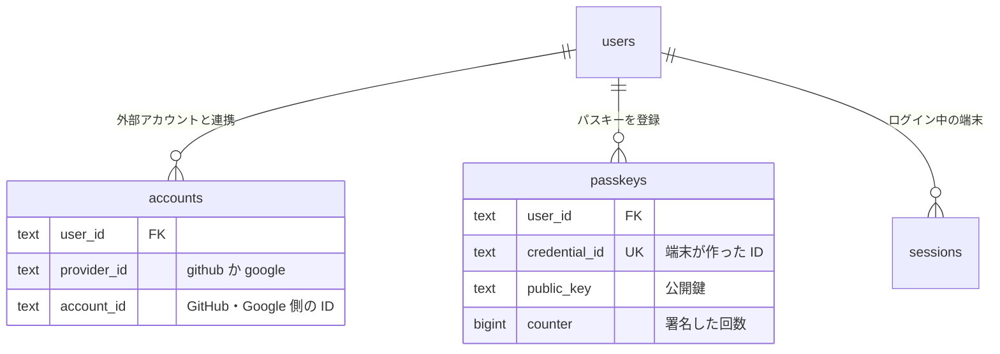
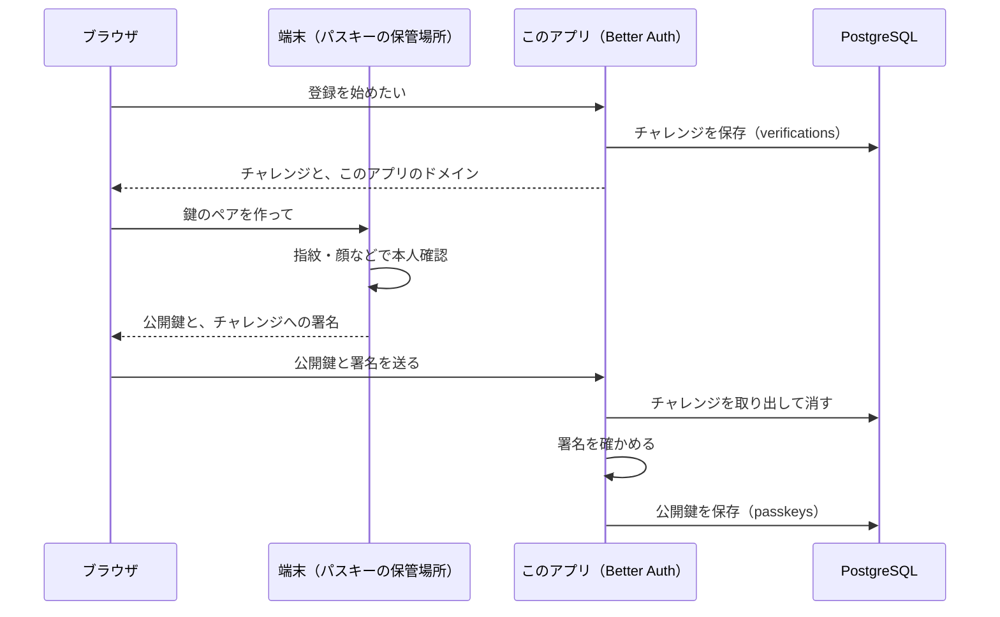
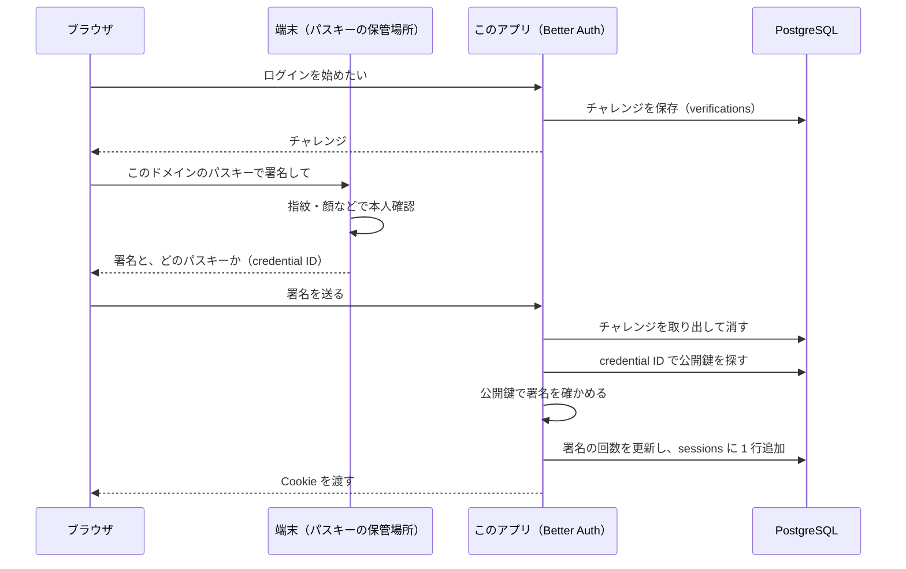
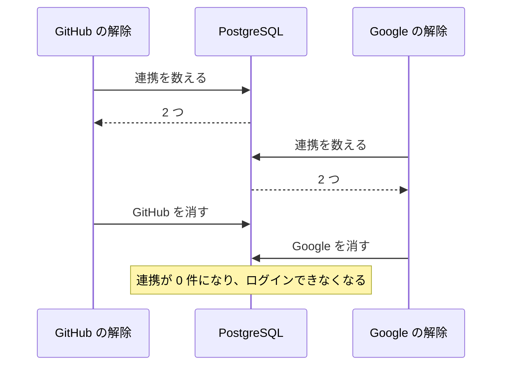

# 04. ログインの仕組み（OAuth・パスキー・連携）

M3 の学習ノートです。「GitHub・Google でログイン」と「パスキーでログイン」のあいだに、ブラウザ・サーバー・DB でそれぞれ何が起きているかを説明します。

ログインの処理の多くはライブラリ（Better Auth）に任せていますが、中で何が起きているかを知っておくと、安全な作りかどうかを自分で判断できるようになります。設計の判断の理由は [ADR-0009](../adr/0009-login-methods.md) にあります。

## まず読む 5 つのファイル

| 順番 | ファイル | 分かること |
| --- | --- | --- |
| 1 | `src/lib/auth.ts` | Google・パスキー・連携の設定 |
| 2 | `src/features/login-methods/components/login-buttons.tsx` | ブラウザ側のログインの始め方（OAuth とパスキー） |
| 3 | `src/features/login-methods/components/passkey-list.tsx` | パスキーの追加（ブラウザ）と削除（Server Action） |
| 4 | `src/features/login-methods/mutations.ts` | 連携の解除と、行のロック |
| 5 | `src/db/schema.ts` の `accounts`・`verifications`・`passkeys` | ログインに使うテーブル |

---

## 1. おさらい: 「ログインしている」とはどういう状態か

ログインに成功すると、サーバーは `sessions` テーブルに 1 行を追加し、その行の合言葉（トークン）を Cookie に入れてブラウザに渡します。以降、ブラウザはページを開くたびにこの Cookie を送り、サーバーは `sessions` を探して「誰か」を判断します（M1）。

**ログインの方法が GitHub・Google・パスキーのどれでも、最後に作るのは同じセッション**です。違うのは「本人だと確かめる方法」だけです。

ページを開くたびに実行される検索なので、速さが大切です。セッションが 10 万件ある状態で測りました。

| `token` の索引 | 時間 | 読んだページ数 |
| --- | --- | --- |
| あり（一意制約が作った索引） | 0.017ms | 4 |
| なし | 7.34ms | 1,640（全件を読む Seq Scan） |

`token` には一意制約（`unique`）が付いていて、PostgreSQL は一意制約を守るために自動で索引を作ります。その索引が、この検索を 400 倍以上速くしています。

---

## 2. OAuth: GitHub・Google でログインする

### 2-1. 流れ



ポイント:

- **パスワードはこのアプリに来ない**: 入力するのは Google の画面。このアプリが受け取るのは「この人は Google の○○さんです」という結果だけ
- **state（使い捨ての合言葉）**: ログインを始めたブラウザと、戻ってきたブラウザが同じかを確かめる。悪い人が自分の code を使わせて、被害者を悪い人のアカウントでログインさせる攻撃（CSRF）を防ぐ。`verifications` テーブルに保存し、使ったら消す
- **PKCE**: 戻ってくるときの code を途中で盗まれても使えないようにする仕組み。GitHub・Google のどちらでも使われている
- **code の交換はサーバーどうし**: 秘密の値（Client secret）はサーバーにしかないので、ブラウザでは交換できない
- **プレビュー環境では本番を経由する**: Google や GitHub に登録できる戻り先の URL は本番の 1 つだけなので、プレビューのログインは本番の URL に戻ってから、プレビューへ受け渡している（ADR-0003 の OAuth Proxy）。そのため、新しいログイン方法（今回の Google）は、本番に入るまでプレビューでは試せない

### 2-2. 1 人に、ログイン方法が複数ある



- `accounts` の 1 行が「GitHub アカウントとの連携」「Google アカウントとの連携」を表す。1 人が何行でも持てる（1 対多）
- `(provider_id, account_id)` の組み合わせには一意制約がある（M1）。**1 つの Google アカウントを 2 人に連携することはできない**
- Google でログインしたとき、サーバーはまず `accounts` を `(google, Google 側の ID)` で探す。見つかれば、その行の `user_id` の人としてログインする

### 2-3. 自動の連携と「事前の乗っ取り」

`accounts` に見つからず、**同じメールアドレスのユーザーがすでにいる**とき（例: GitHub で登録した人が、初めて Google でログインした）はどうするか。

Better Auth は、**両方のメールアドレスが確認済みのときだけ**、自動で連携します（初期設定のまま）。どちらかが未確認なら断り、ログイン画面に「前回と同じ方法でログインしてから、設定画面で連携してください」と表示します（`src/app/login/page.tsx`）。

**なぜ「確認済み」が必要か**: 悪い人が、被害者のメールアドレスで先に（確認せずに）アカウントを作っておいたとします。あとで被害者が Google でログインしたときに自動で連携すると、被害者は悪い人の作ったアカウントを使うことになり、悪い人もそのアカウントにログインできてしまいます（事前の乗っ取り）。メールアドレスが確認済みなら、そのアドレスの持ち主が作ったアカウントだと分かるので、この攻撃は成り立ちません。

設定画面から連携するときは、メールアドレスが違っていても連携できるようにしています（`allowDifferentEmails`）。ログイン中の本人が、連携するアカウントでもログインして確かめるからです。

---

## 3. パスキーでログインする

### 3-1. 仕組み: 鍵のペアと署名

**なぜ必要か**: パスワードは、偽サイトに入力すると盗まれます。サーバーから漏れたときも危険です。パスキーはこの 2 つの弱点がありません。

**どう動くか**: パスキーは「秘密鍵」と「公開鍵」のペアです。

- **秘密鍵**: 端末（iCloud キーチェーンや Google パスワードマネージャーなど）の中から出ない。署名を作るのに使う
- **公開鍵**: サーバー（`passkeys` テーブル）に保存する。署名が本物かを確かめるのに使う。公開鍵から秘密鍵は計算できないので、漏れても困らない

ログインのたびに、サーバーは毎回違うランダムな値（**チャレンジ**）を送り、端末はそれに秘密鍵で署名して返します。サーバーは公開鍵で署名を確かめます。同じ署名は二度と使えません。

**偽サイトで使えない理由**: パスキーは作ったときのドメイン（このアプリの URL）に結びつけられ、ブラウザは違うドメインのサイトにはそのパスキーを使わせません。さらに、署名する内容にはブラウザが「今開いているサイトの URL」を入れるので、サーバーはそれも確かめます（`auth.ts` の `rpID` と `origin`）。

### 3-2. 登録（設定画面の「パスキーを追加」）



### 3-3. ログイン（「パスキーでログイン」）



### 3-4. サーバーとブラウザの分担

| 場所 | やること | このアプリのどこか |
| --- | --- | --- |
| ブラウザ | 端末に「鍵を作って」「署名して」と頼む（WebAuthn という仕組み） | `login-buttons.tsx`・`passkey-list.tsx` から `authClient` を呼ぶ |
| 端末 | 本人確認（指紋・顔）、鍵の保管、署名 | （OS とパスワード管理アプリの仕事） |
| サーバー | チャレンジを作る、署名を確かめる、セッションを作る | Better Auth のパスキーのプラグイン（`auth.ts`） |
| DB | チャレンジ、公開鍵、署名の回数、セッション | `verifications`・`passkeys`・`sessions` |

鍵を作ったり署名したりするのは、ブラウザと端末にしかできません。だから、パスキーのボタンは Client Component です。一方、パスキーの一覧の表示と削除は DB だけで済むので、Server Component と Server Action にしています。

ログインに成功したあとは `router.refresh()` でページを描き直します。サーバーがログイン済みだと分かると、ログインページの `RedirectIfSignedIn` がホームへ移動させます（`src/app/login/page.tsx`）。

### 3-5. 実際に流れた SQL

E2E テストでパスキーを登録してログインしたときに、PostgreSQL のログ（`log_statement = 'all'`）で記録した SQL です（列の一覧などを省略しています）。

**登録**

```sql
-- 「パスキーを追加」: 登録済みのパスキーを調べる（同じ端末の二重登録を防ぐため、端末に伝える）
select ... from passkeys where user_id = $1 limit 100;
-- チャレンジを保存する。identifier は Cookie に入れる使い捨ての合言葉
insert into verifications (id, identifier, value, expires_at, ...) values (...);

-- 端末から署名が届いたら: チャレンジを取り出して、すぐに消す（1 つのトランザクション）
begin;
select ... from verifications where identifier = $1 order by created_at desc limit 1;
delete from verifications where id in (select id from verifications where id = $1 limit 1) returning ...;
delete from verifications where identifier = $1;
commit;
-- 署名を確かめたら、公開鍵を保存する
insert into passkeys (id, name, public_key, user_id, credential_id, counter, ...) values (...);
```

**ログイン**

```sql
insert into verifications (...) values (...);            -- チャレンジを保存
-- 署名が届いたら、チャレンジを取り出して消す（登録と同じ 3 文）
select ... from verifications where identifier = $1 ...;
delete from verifications where id in (...) returning ...;
delete from verifications where identifier = $1;
select ... from passkeys where credential_id = $1;      -- どのパスキーかを探す
update passkeys set counter = $1 where id = $2;          -- 署名の回数を更新
insert into sessions (...) values (...);                 -- ログイン状態を作る
```

`credential_id` には一意制約を付けたので、その索引でパスキーを探せます。

### 3-6. チャレンジは 1 回しか使えない

チャレンジを取り出すときは、`delete ... returning`（消して、消した行を返す）を使っています。同じチャレンジへの署名が 2 回同時に届いても、行を消して受け取れるのはどちらか片方だけです。もう片方は「チャレンジが見つからない」になるので、盗み見た署名をもう一度送る攻撃（リプレイ攻撃）は成り立ちません。

### 3-7. 署名の回数（counter）

端末は、署名するたびに数を 1 増やして送ってきます（iCloud キーチェーンなど、同期するパスキーは常に 0 のこともあります）。サーバーは前回の数を保存しておき、増えていなければ「パスキーが複製されたかもしれない」として断ります。数は 0〜約 42 億（符号なし 32 ビット）なので、`integer`（約 21 億まで）ではなく `bigint` にし、CHECK 制約で範囲も守っています（`src/db/schema.ts`）。

### 3-8. プレビュー環境とパスキー

パスキーは 1 つのドメインにしか結びつけられません。プレビュー環境には URL が 2 種類（デプロイごと・ブランチごと）あるので、PR のコメントに出る「ブランチごとの URL」に決めています（`auth.ts` の `resolvePasskeyOrigin`）。本番で作ったパスキーは本番でだけ、プレビューで作ったパスキーはそのプレビューでだけ使えます。

---

## 4. 連携の解除と、行のロック

### 4-1. 何が起きるか

「最後の 1 つは解除できない」というルールは、「今いくつ連携しているかを数える → 2 つ以上なら消す」の 2 段階です。GitHub と Google の解除がほぼ同時に届くと、M2 の画像の上限と同じことが起きます。



### 4-2. その人の行だけをロックする（SELECT ... FOR UPDATE）

```ts
await db.transaction(async (tx) => {
  // この人の users の行をロックする
  await tx.select({ id: users.id }).from(users).where(eq(users.id, userId)).for("update");
  const linked = await tx.select(...).from(accounts).where(eq(accounts.userId, userId));
  if (linked.length <= 1) throw new UserFacingError("ログインできなくなるため、最後の 1 つは解除できません");
  await tx.delete(accounts).where(...);
});
```

`for update` を付けた SELECT は、読んだ行をロックします。同じ行を `for update` で読もうとしたほかのトランザクションは、先のトランザクションが終わるまで待たされます。2 つ目の解除は、1 つ目が終わってから数えるので「1 つしかない」と分かり、断られます。

### 4-3. 実験

`src/features/login-methods/login-methods.test.ts` の「GitHub と Google の解除が同時に届いても…」のテストで確かめました。

| ロック | 結果 |
| --- | --- |
| なし（`for update` を外して試した） | 5 回中 3 回、両方とも解除された（連携 0 件） |
| あり | 10 回中 10 回、片方だけが解除された |

### 4-4. M2 のアドバイザリロックとの違い

| | M2: アドバイザリロック | M3: 行のロック |
| --- | --- | --- |
| ロックするもの | アプリが決めた番号（`1001`） | 実在する行（その人の `users` の行） |
| 待たされる範囲 | 全員の予約が 1 つずつ順番になる | 同じ人の解除だけが順番になる。ほかの人は待たない |
| 向いている場面 | サービス全体で数える上限（月 1,600 枚など） | 1 人ぶんのデータの決まり（連携を 1 つは残す） |

画像の上限は「全員の合計」で決まるので、全員を順番に並ばせる必要がありました。連携の解除は「その人の中」で完結するので、その人の行だけをロックすれば十分です。ロックする範囲は、守りたい決まりの範囲に合わせて選びます。

---

## 5. 投稿の共有ボタン（ブラウザの機能）

**なぜ必要か**: 投稿のリンク（URL）を LINE などに送る方法が分かりにくかったため。

**どう動くか**: スマホのブラウザには、OS の共有メニュー（LINE などのアプリを選べる画面）を開く機能（Web Share API の `navigator.share`）があります。パソコンのブラウザなど、この機能がないときは、リンクをクリップボードにコピーします。どちらもブラウザの機能なので、Client Component です（`src/features/posts/components/share-button.tsx`）。

---

## 読まなくてよいファイル

| ファイル | 中身 |
| --- | --- |
| `src/features/login-methods/components/linked-accounts.tsx`・`login-methods-section.tsx` | 連携の一覧と、設定画面の配置（見た目） |
| `src/features/login-methods/queries.ts`・`actions.ts`・`validation.ts` | 一覧の取得と、Server Actions（これまでと同じ形） |
| `src/features/posts/components/share-button.tsx` | 共有ボタン |
| `drizzle/0003_passkeys.sql` | passkeys テーブルを作る SQL（`schema.ts` から作られたもの） |
| `src/**/*.test.ts`、`e2e/`、`tests/` | テスト |

---

## 確認クイズ（任意）

1. GitHub・Google・パスキーのどれでログインしても、最後に作られるものは何？
2. OAuth の state は、どんな攻撃を防ぐためのもの？
3. ログイン画面からの自動の連携を「両方のメールアドレスが確認済みのとき」に限っているのはなぜ？
4. パスキーの公開鍵が DB から漏れても困らないのはなぜ？
5. パスキーが偽サイトで使えないのはなぜ？
6. 連携の解除で、M2 のようなアドバイザリロックではなく、行のロックを使ったのはなぜ？

<details>
<summary>答え</summary>

1. `sessions` テーブルの行（と、その合言葉を入れた Cookie）
2. 悪い人が自分の code を使わせて、被害者を悪い人のアカウントでログインさせる攻撃（CSRF）
3. 他人のメールアドレスで先に作られたアカウントに連携させられて、乗っ取られるのを防ぐため（事前の乗っ取り）
4. 公開鍵からは秘密鍵を計算できず、署名を作るには秘密鍵が必要だから
5. パスキーは作ったときのドメインに結びつけられ、ブラウザが違うドメインのサイトには使わせないから。署名する内容にも開いているサイトの URL が入り、サーバーが確かめる
6. 守りたい決まり（連携を 1 つは残す）が、その人のデータの中で完結するから。その人の行だけをロックすれば、ほかの人を待たせずに済む

</details>
